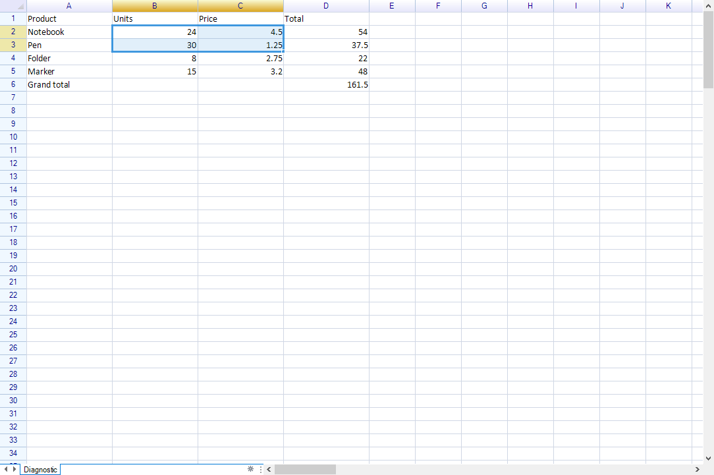

# ReoGrid local diagnostic host

The host exercises the real WinForms `unvell.ReoGrid.ReoGridControl` in `ReoGridDemo.exe`. It is a standalone diagnostic workbook, not the demo browser. Each run receives a dedicated Windows desktop and a checkout-specific profile, so the diagnostic window and its interactions stay separate from the user's desktop. Commands use a current-user-only named pipe and execute worksheet/control work on the WinForms UI thread.

## Start and reconnect

Run from the repository root in PowerShell:

```powershell
.DemoDiagnosticsReoGrid-Diagnostic.ps1 start
.DemoDiagnosticsReoGrid-Diagnostic.ps1 status
.DemoDiagnosticsReoGrid-Diagnostic.ps1 state
```

`start` builds the WinForms demo and desktop supervisor, starts one isolated process, and waits for a live health response. The repo currently requires `Platform=AnyCPU` for its conditional build symbols; the entry script supplies it. A session descriptor is stored under `%LOCALAPPDATA%\ReoGrid\Diagnostic\<checkout-id>\session.json`. It identifies protocol version, pipe, application PID and exact executable, profile, build GUID, start time, and isolated desktop. A subsequent `start` reconnects to a responsive process. If a descriptor names a live but unresponsive PID, the command reports it and does not launch a duplicate.

## Grid commands

```powershell
.DemoDiagnosticsReoGrid-Diagnostic.ps1 request -Command select -Range B2:C3
.DemoDiagnosticsReoGrid-Diagnostic.ps1 request -Command setCell -Address B2 -Value 24
.DemoDiagnosticsReoGrid-Diagnostic.ps1 state
.DemoDiagnosticsReoGrid-Diagnostic.ps1 screenshot
.DemoDiagnosticsReoGrid-Diagnostic.ps1 stop
```

The workbook starts with a small inventory. `state` returns worksheet name, selected range, focus cell and the A1:D6 values. `setCell` and `select` use `Worksheet.SetCellData` and `Worksheet.SelectionRange`. Responses distinguish `completed` from `failed`; a client timeout is not an operation cancellation, so query `state` before repeating a mutation. `screenshot` captures the ReoGrid control via WinForms `DrawToBitmap` and writes a PNG into the session profile. The surface is the grid only, not the containing form chrome.

## Verified scenario

On 2026-10-27, the isolated host started and answered `health`; selection changed to B2:C3; B2 changed from 12 to 24; `state` confirmed B2=24, selection B2:C3, and focus B2; `screenshot` produced a 1084×721 PNG showing the changed value and selected cells. This verifies the application worksheet model and the rendered WinForms grid. It does not exercise formula editing, native dialogs, file open/save or other demo pages.

The desktop supervisor keeps the named desktop handle open for the lifetime of the app and closes it after the app exits. `stop` sends the app's shutdown request and waits for its session descriptor to disappear. It only closes the diagnostic process it started; it does not search for or terminate other ReoGrid processes. Diagnostic profile files remain available for inspection. Remove that profile manually only after stopping the session if you no longer need its logs or captures.


